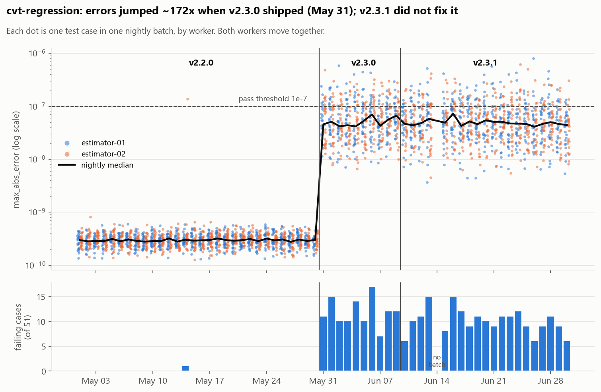

# cvt-regression nightly: what's going on

**Short version:** The nightly started going red on **2026-05-31**, the first batch run on **v2.3.0**. On that night `max_abs_error` jumped about **170×**, on every test and on both workers, and it has stayed there. **v2.3.1** (from 2026-06-10) did not fix it. The failures aren't flaky tests and they aren't a bad worker. The numerical accuracy of the filter got worse with v2.3.0. The errors now sit about 2× below the 1e-7 threshold, so a random ~20% of cases land above it each night.

## Data

- `validation_runs.csv`: 3,060 rows, 60 nightly batches (2026-05-01 to 2026-06-30), 51 test cases (ids 1800–1850) per batch. No missing values and no duplicate (batch, test_id) rows.
- **There is no batch for 2026-06-14.** It's missing from the export, so either the nightly didn't run that night or the export dropped it.
- `n_vectors` is 1500 on every row, so the input size never changed.
- Each test always runs on the same worker: 25 tests on `estimator-01` and 26 on `estimator-02`, the same split every night.
- Versions: v2.2.0 from 05-01 to 05-30 (30 batches), v2.3.0 from 05-31 to 06-09 (10 batches), v2.3.1 from 06-10 to 06-30 (20 batches, missing 06-14). Each batch ran a single version.

Analysis code: `analyze.py`. It regenerates `findings.json` and the plot.

## When it started

| | Nightly median error | Failing cases per night |
|---|---|---|
| v2.2.0 (05-01 to 05-30) | 2.8e-10 to 3.2e-10 | 0 every night except one case on 05-14 |
| 05-31 onward | 4.1e-8 to 7.3e-8 | 6 to 17 every night (mean 10.6 of 51) |

It's a clean step with no gradual drift before it. The 05-30 batch looks like every other v2.2.0 night. On 05-31 every test case moved up. **The lowest error recorded after the change (3.7e-9) is still 4.5× higher than the worst normal v2.2.0 result (8.2e-10).** Apart from the single 05-14 outlier (1.38e-7, covered below), the before and after distributions don't overlap.

## How big the effect is, per version

| version | runs | mean max_abs_error | median max_abs_error | fail rate |
|---|---|---|---|---|
| v2.2.0 | 1530 | 3.97e-10 | 2.96e-10 | 0.07% (1 / 1530) |
| v2.3.0 | 510 | 7.40e-8 | 5.09e-8 | 23.1% (118 / 510) |
| v2.3.1 | 1020 | 6.95e-8 | 4.78e-8 | 19.6% (200 / 1020) |

- **Magnitude:** the median error for v2.3.0 is **171.8×** the v2.2.0 median (the means differ by 186×). On a log scale, the typical error went from about 10^-9.5 to 10^-7.3, and the spread grew too (sd of log10 error went from 0.14 to 0.37).
- **v2.3.1 did not fix it.** Its median is 161× the v2.2.0 median, and its error distribution is statistically the same as v2.3.0's (Mann-Whitney p = 0.11). Its slightly lower fail rate (19.6% vs 23.1%) is within the night-to-night noise.

## Explanations the data rules out

**Worker machine: ruled out.**
- Both workers jumped on the same night by the same amount. Medians by version and worker:
  - v2.2.0: estimator-01 2.94e-10, estimator-02 2.99e-10
  - v2.3.0: estimator-01 4.99e-8, estimator-02 5.13e-8
  - v2.3.1: estimator-01 4.93e-8, estimator-02 4.72e-8
- Fail rates are similar on both workers (v2.3.0: 24.0% vs 22.3%; v2.3.1: 20.2% vs 19.0%). Error doesn't differ by worker under any version (Mann-Whitney p = 0.21, 0.82, 0.19).
- The workers do differ in one thing: `estimator-02` is consistently slower (median runtime 55.8 ms vs 47.6 ms). That gap is the same before and after the change, and runtime didn't shift on 05-31 (p = 0.41 comparing the week before with the week after). It's probably why people suspected that machine, but it has nothing to do with accuracy.

**Flaky tests: ruled out as the cause, though they explain why it looks flaky.**
- If a few bad tests were responsible, failures would cluster on them. They don't:
  - After the change, **all 51 tests failed at least once**, with per-test fail rates between 7% and 37%.
  - Failure count doesn't depend on which test it is (chi-square p = 0.68).
  - A test's average error in the first half of the post-change period barely predicts its average in the second half (correlation 0.06).
- The night-to-night swings (6 to 17 failures) match the spread you'd expect if each case independently had about a 21% chance of failing: the binomial sd would be 2.9, and the observed sd is 2.7.
- So the "flakiness" is real, but it's a symptom. Every case's error moved up to just below the threshold, and normal run-to-run noise now pushes about a fifth of them over it on any given night.

**Gradual drift or a change in test inputs: ruled out.** v2.2.0 is flat for 30 nights, the jump happens in a single step, `n_vectors` never changes, and the set of test cases is identical before and after.

**The one v2.2.0 failure (2026-05-14, test 1838, estimator-02, 1.38e-7)** is a one-off. That test's other 29 v2.2.0 runs have a median of 3.1e-10. This was the only failure in 30 nights, and it isn't related to the regression.

## What the data can't separate

Version and date are perfectly confounded: v2.3.0 went out on the same night the errors jumped. Strictly speaking, the data shows that the regression **coincides exactly with the v2.3.0 rollout**. If something else changed in the CI environment on 05-31, such as reference outputs, a compiler or BLAS update, or build flags, this export can't tell it apart from the code change. The size of the jump (about 2 orders of magnitude, uniform across tests) looks like a precision or algorithm change, for example float32 somewhere in the path, a changed accumulation order, or a looser internal tolerance.

## Suggested next steps

1. Diff v2.2.0 against v2.3.0 for anything touching numeric precision in the filter path: dtypes, accumulation, tolerances, dependency bumps.
2. Re-run v2.2.0 on today's CI on both workers. If it comes back around 3e-10, the code change is confirmed and environmental causes are out.
3. Don't treat this as flakiness. Retrying or raising the threshold would hide a 170× loss of accuracy.
4. Find out why the 2026-06-14 batch is missing.
